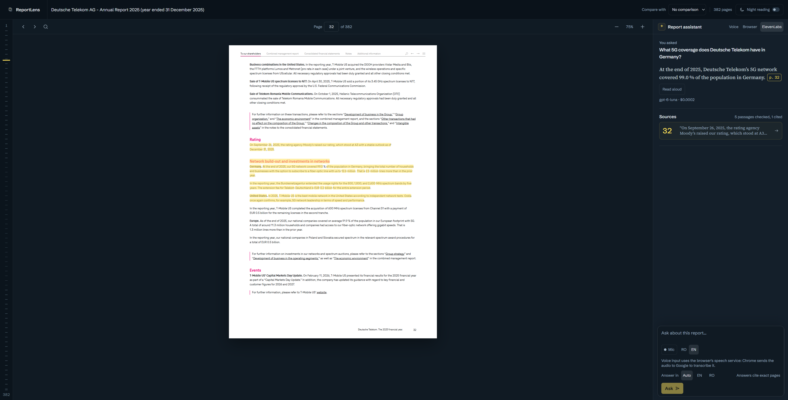
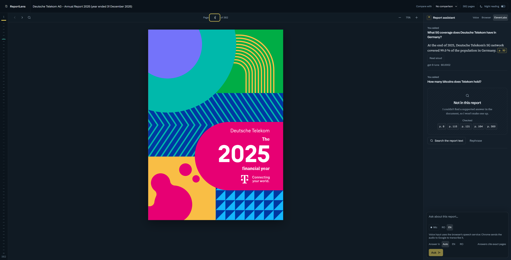
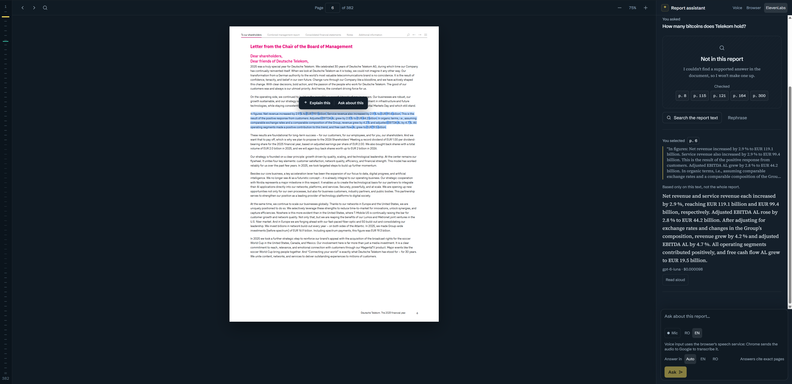
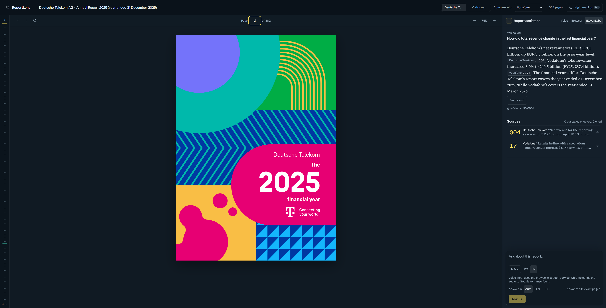
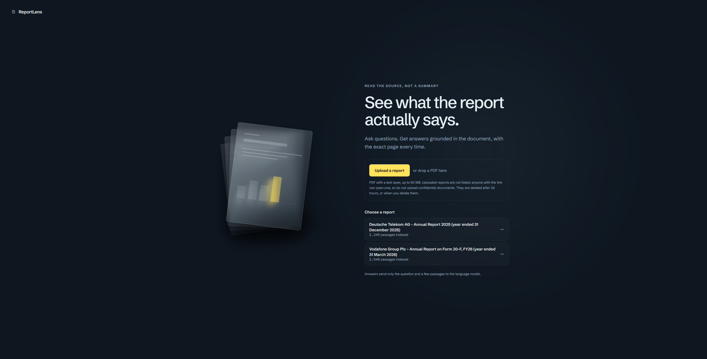
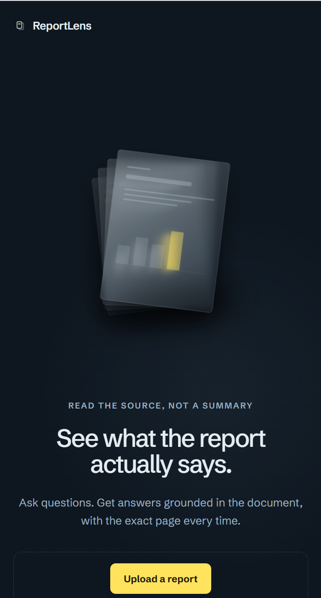
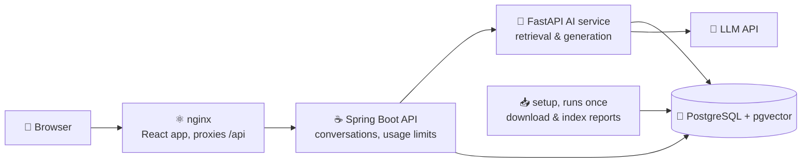

<div align="center">

# 🔍 ReportLens 🔍

### Read annual reports with an AI assistant that explains and **cites** everything

*Select any paragraph, table or number in a report, ask a question, and get an answer that points to the exact page it came from.*


[🐳 Run it](#-getting-started) · [🖼️ Screenshots](#%EF%B8%8F-screenshots) · [🏗️ Architecture](#%EF%B8%8F-architecture) · [🗺️ Roadmap](#%EF%B8%8F-roadmap)

</div>

---

<div align = "center"> 
  # ✨ What is ReportLens? 
</div>

Annual reports are long, dense and full of tables. **ReportLens** is a report viewer with an AI assistant built next to it: the PDF is on the left, the assistant is on the right, and every answer links back to the page and passage it is based on.

It is built as a **Retrieval-Augmented Generation (RAG)** system, so the assistant answers only from the documents you load, and says **"Not in this report"** instead of guessing.

> 📌 This is a personal portfolio project, tested on publicly available telecom annual reports. It is not affiliated with any company.

## 🖼️ Screenshots

**Every answer cites its page**, and the cited passage is highlighted in the PDF.



**Not in the report: it says so instead of guessing.**



**Select & explain**: select a passage and ask about it.



**Compare two reports**: each figure cites its report and page.



**Start screen** (desktop and phone): upload a PDF or choose a report.



<div align="center">
  
</div>

## 🎯 Features

- 📄 **Report viewer with an AI side panel**: read the PDF and ask questions in the same screen
- 🖍️ **Select & explain**: highlight a paragraph or table and press *Explain this* for a plain-language explanation
- 📌 **Verifiable citations**: every answer links to the page, with the source passage highlighted
- 🔎 **Hybrid search**: semantic search (embeddings) combined with keyword search (BM25) and re-ranking, so numbers and names are more likely to be found
- 🚫 **"Not in the report" mode**: the assistant refuses to answer when there is no supporting source
- 🆚 **Compare two reports**: each report is searched on its own, every figure cites its report and page, and the assistant says when the financial years differ
- 🌍 **Ask in Romanian or English**: multilingual embeddings, documents in English
- 📤 **Upload your own PDF** (when the server allows it): ingested in the background with visible progress, then searchable, citable and comparable with another report
- 🔊 **Voice** (optional): ask by voice (Romanian or English) and have answers read aloud, by the browser's voice or ElevenLabs (the default when the server has a key); see [Voice](#-voice)
- 📊 **Evaluation** (in progress): a hand-written test set with expected pages; results so far are in [Evaluation](#-evaluation)

## 🎬 Demo

Run it on your machine with one command (see [Getting started](#-getting-started)). There is no public instance yet.
See the [screenshots](#%EF%B8%8F-screenshots) above.

## 🏗️ Architecture



In Docker Compose these are five services: `db`, `setup` (one-shot), `ai-service`, `backend` and
`frontend`. Only the frontend is published, on `127.0.0.1`; the others are reachable inside the
Docker network only. The LLM key is passed to the `ai-service` container alone.

**How a question is answered**

1. 📥 **Ingestion**: PDFs are split into page-aware chunks, embedded, and stored in pgvector
2. 🔎 **Retrieval**: hybrid search (semantic + BM25), then re-ranking
3. 🧠 **Generation**: the language model answers using only the retrieved passages
4. 📌 **Citation**: the answer is returned with document, page and passage references
5. 🚫 **Guardrail**: if nothing relevant is found, the assistant says so

## 🧰 Tech stack

| Layer | Technology |
|---|---|
| 🖥️ Frontend | React, Tailwind CSS, pdf.js |
| ☕ Backend | Java, Spring Boot |
| 🐍 AI service | Python, FastAPI, sentence-transformers |
| 🗄️ Database | PostgreSQL + pgvector |
| 🐳 DevOps | Docker, Docker Compose |

## 🚀 Getting started

### 🐳 With Docker (one command)

Requirements: Docker with Compose v2, and an OpenAI API key.

```bash
git clone https://github.com/dragos1250/reportlens.git
cd reportlens
cp .env.example .env    # then set LLM_API_KEY and POSTGRES_PASSWORD (never commit .env)
docker compose up --build
```

Then open **http://127.0.0.1:8088**.

The first start builds the images, then the `setup` service downloads the two public reports
listed in `scripts/reports.json` from their official sources (checking their sha256), splits them
into passages, embeds them on the CPU and loads them into PostgreSQL. The other services wait for
it. Later starts skip the steps already done. Measured on the author's Windows laptop
(Docker Desktop), from a fresh clone: building the images took 154 s (some base images were
already pulled), then 192 s until every service was healthy, most of it reading and embedding
the 970 pages on the CPU. A second start took 29 s. The `ai-service` image is 2.94 GB: CPU-only
PyTorch and the embedding model are inside, so a container starts without downloading anything.

The reports and everything derived from them live in Docker volumes, never in the repository.
`docker compose down -v` removes them.

**Protections** (on the route that may call the LLM; values in `.env`): 10 questions per minute
per client IP, an estimated LLM cost of $0.05 per IP and $1.00 overall per UTC day, questions up to
1,000 characters and selections up to 5,000. Past a limit the API answers `429` with `Retry-After`
and makes no LLM call. Behind nginx the client IP comes from `X-Forwarded-For`, which the backend
trusts only from the nginx container's fixed address.

**Uploads** (on when `UPLOADS_ENABLED=true`, as in `.env.example`; **off** in the code's default,
so a public instance without the variable accepts none): PDFs up to 50 MB and 600 pages, with a
text layer on at least half of the pages; 3 uploads per hour per client IP, one at a time, at
most 20 kept on the server, each deleted after 24 hours. The file is checked by its bytes, not its
name, stored under a random id, and parsed in a separate process with a time limit (10 minutes);
the page count is checked before any text is read. Ingestion is local: no LLM call, no cost. It runs on the server's
CPU, one upload at a time, so **answers can be slower while a report is being ingested**.
Uploaded reports are not listed; anyone with the link can open one, so do not upload confidential
documents.

### 🔊 Voice

- **Asking by voice** uses the browser's speech recognition (Chrome, Edge; not Firefox), in
  Romanian or English (switch next to the Mic button). **Chrome sends the audio to Google to
  transcribe it.** The words go into the question field and are never sent on their own.
  Alt+M starts and stops, Esc stops.
- **Reading answers aloud** reads the first whole sentences (up to 400 characters, without the
  citation markers; the citations stay on screen), in the language of the answer.
  - **ElevenLabs is the default when the server has a key** (see below); the reader can switch to
    the browser voice, and the choice is remembered.
  - The **browser voice** is free and nothing leaves the device; it is used without a key, for
    uploaded reports and past a spending limit. If no voice is installed
    for the answer's language (often Romanian on Windows), the app says so instead of reading
    with another voice.
  - **ElevenLabs** (model `eleven_v4_turbo` by default, set by `ELEVENLABS_MODEL`; in the author's
    manual check `eleven_flash_v2_5` misread numbers with the same voice, `eleven_v4_turbo` did not)
    works only when the server
    has `ELEVENLABS_API_KEY` and `ELEVENLABS_VOICE_ID`. The backend reads the answer it wrote,
    by its id, and sends ElevenLabs only the text to read. Before any paid call: 5 requests a minute
    per IP, 2,000 characters a day per IP, 20,000 a day overall and a monthly cap (8,000 by default,
    under the free plan); past a limit the browser voice reads instead, with the reason shown.
    Audio already made is replayed from memory (last 50 answers) without paying again.
  - **Uploaded reports are read with the browser voice only**: their text never goes to ElevenLabs.

### 🛠️ Development without Docker (Windows PowerShell)

Requirements: Docker Desktop (for the database), Python 3.11, Java 25, Node.js 22. Maven is not
needed (`mvnw` downloads it).

**One-time setup**

```powershell
# Configuration: copy the example, then fill in LLM_API_KEY and POSTGRES_PASSWORD (never commit .env)
Copy-Item .env.example .env

# Python environment for the AI service
cd ai-service
py -3.11 -m venv .venv
.\.venv\Scripts\python.exe -m pip install -r requirements.txt

# Download the public reports (scripts/reports.json), split them into passages, embed them
.\.venv\Scripts\python.exe ..\scripts\download_reports.py
.\.venv\Scripts\python.exe -m ingestion.ingest ..\data\raw\vodafone-20f-fy26.pdf --doc-id vodafone-20f-fy26
.\.venv\Scripts\python.exe -m retrieval.build_index --doc-id vodafone-20f-fy26
.\.venv\Scripts\python.exe -m ingestion.ingest ..\data\raw\dtag-ar-2025.pdf --doc-id dtag-ar-2025
.\.venv\Scripts\python.exe -m retrieval.build_index --doc-id dtag-ar-2025

# Database (port published on 127.0.0.1 by the dev file), then load passages and vectors into it
cd ..
docker compose -f docker-compose.yml -f docker-compose.dev.yml up -d db
cd ai-service
.\.venv\Scripts\python.exe -m storage.load --doc-id vodafone-20f-fy26
.\.venv\Scripts\python.exe -m storage.load --doc-id dtag-ar-2025
cd ..
```

**Run** (one terminal per service, from the repository root)

```powershell
# Terminal 1: AI service on http://127.0.0.1:8000
cd ai-service
.\.venv\Scripts\python.exe -m uvicorn api.main:app --port 8000
```

```powershell
# Terminal 2: backend on http://127.0.0.1:8080 (reads the database password from .env into this terminal only)
cd backend
$env:POSTGRES_PASSWORD = ((Get-Content ..\.env) -match '^POSTGRES_PASSWORD=') -replace '^POSTGRES_PASSWORD=', ''
.\mvnw.cmd spring-boot:run
```

```powershell
# Terminal 3: frontend on http://127.0.0.1:5173 (proxies /api to the backend)
cd frontend
npm install
npm run dev
```

Then open **http://127.0.0.1:5173**.

**Tests**

```powershell
cd ai-service; .\.venv\Scripts\python.exe -m pytest -q; cd ..
cd backend; .\mvnw.cmd test; cd ..
cd frontend; npm test; cd ..
# nginx as in Docker: content types (.js, .mjs, .css), the app's routes, 404s; needs Docker
py -3.11 scripts/check_nginx.py
```

## 📏 Evaluation

Quality is measured, not assumed, but the test set is still small: **10 retrieval questions
(5 Romanian-English pairs) and 12 out-of-scope questions, on the Vodafone report only**. The
second report (Deutsche Telekom) is not evaluated yet. The full set (30-50 questions) and a
metrics page come in the evaluation stage. Results so far, from
[`ai-service/NOTES.md`](ai-service/NOTES.md) and [`backend/NOTES.md`](backend/NOTES.md):

| Measure (Vodafone Form 20-F FY26) | Result |
|---|---|
| 🎯 Expected page in the top 5 passages (hit@5), hybrid search | 5/10 (English 3/5, Romanian 2/5) |
| 🎯 Expected page in the top 20 (hit@20), hybrid search | 8/10 |
| ✅ Answers that cite an expected page (gpt-6-luna) | 4/10 |
| 🚫 Correct refusals on out-of-scope questions | 12/12 (guard 1, model 11) |
| ⚠️ Wrong refusals on answerable questions | 6/10 |
| 💵 Cost of those 22 questions | $0.003843 |

The wrong refusals happen when the search misses the passage that holds the answer: the
model then sees no supporting passage and says "not in the report" rather than guess (the guard
refused none of these questions). These figures come from an early configuration on a small set;
the evaluation stage measures them again and tests improvements (re-ranking, query translation,
the guard's threshold) on a separate dev set, with a test set kept for one final measurement.

The metric definitions are in [`eval/README.md`](eval/README.md). Romanian questions are the
weak spot: the keyword search only helps when they share names, numbers or dates with the
English text.

## 🗺️ Roadmap

- [x] 🎬 Project setup and repository
- [x] 📥 PDF ingestion and chunking with page metadata
- [x] 🧭 Semantic search with embeddings (CLI prototype)
- [x] 💬 Question answering with citations (CLI prototype)
- [x] 🔎 Hybrid search and re-ranking
- [x] 🚫 "Not in the report" guardrail
- [x] ☕ Spring Boot API and database
- [x] ⚛️ React UI with PDF viewer and highlighted citations
- [x] 🖍️ Select & explain
- [x] 🆚 Compare two reports (the formal evaluation still covers the Vodafone report only; it is extended in the evaluation stage)
- [x] 🐳 Docker Compose: the whole app with one command
- [x] 🖼️ Screenshots in this README
- [ ] 📏 Evaluation page and full test set, plus a check that the PDF viewer renders in a real browser (in progress: the evaluation tooling and the 29-question dev set are done; the sealed test set and its one-time measurement follow)
- [x] 📤 Upload a PDF, ingest it in the background with progress, compare two uploaded reports (checked in the browser: upload, progress, an answer, deletion)
- [x] 🔊 Voice: ask by voice, answers read aloud
  - [x] Answers read aloud with ElevenLabs (`eleven_v4_turbo`), checked in the browser
  - [x] A clear message when the browser has no voice for the answer's language, checked in the browser
  - [x] Voice input in Romanian and English, Alt+M and Esc, and the message where the browser has no
    speech recognition (Firefox): implemented and covered by automated tests, not yet checked by hand
  - [x] ElevenLabs credits used by one reading: not measured yet
- [ ] 🌐 Public demo (only with the protections above, after the evaluation)

## 📂 Project structure

```text
reportlens/
├── frontend/       # React app (viewer + chat)
├── backend/        # Spring Boot API
├── ai-service/     # FastAPI: ingestion, retrieval, generation
├── eval/           # test questions and evaluation scripts
├── scripts/        # helper scripts (download reports, etc.)
├── data/           # local only, git-ignored (downloaded PDFs, caches)
└── docker-compose.yml
```

## ⚠️ Notes

- 📚 Reports are **not stored in this repository**; a script downloads them from their official public sources.
- 🔑 API keys live only in environment variables on the server, never in the frontend or the repo.
- 🤖 The assistant can make mistakes: always check the cited page.
- 📄 **Only PDFs with a text layer.** Text is read with pdfplumber; there is no OCR.
- 📊 **Tables stay in the running text**, row by row with their labels and numbers. Table
  detection is off by default: on the Vodafone report it found 505 "tables", of which only 7
  were plausible, and it lost data (see [`ai-service/NOTES.md`](ai-service/NOTES.md)).
- 📤 **Uploaded reports are indexed automatically, with rules calibrated on two reports.** The
  header/footer cleaning, the table handling and the "not in the report" threshold were tuned on the
  Vodafone and Deutsche Telekom reports only; on other layouts they may do worse. The app says so on
  every uploaded report and shows how many of its pages have no text layer. No quality figure is
  claimed for uploads.
- 🧮 **Usage limits per IP are kept in memory** and reset when the backend restarts; the global
  daily total is read from the database.
- 🖨️ **Scanned pages are not covered.** Pages without a text layer are neither indexed for the assistant nor searchable with "Search the report text" (there is no OCR). In the test report (Vodafone Form 20-F FY26, 588 pages), 116 pages have no text layer and the same 116 pages have no passage in the database: an exact overlap, mostly scanned exhibits (pages 262, 341-401 and 480-581, with gaps).

## 📜 License

Released under the [MIT License](LICENSE).

## 👤 Author

**Dragoș-Mihai Răducanu** · repository: [github.com/dragos1250/reportlens](https://github.com/dragos1250/reportlens)

[](https://github.com/dragos1250)
[](https://www.linkedin.com/in/<your-profile>)
