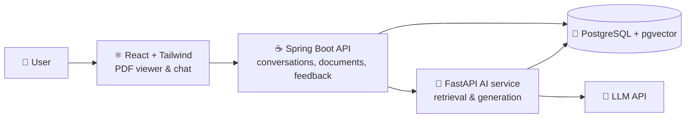

<div align="center">

# 🔍 ReportLens 🔍

### Read annual reports with an AI assistant that explains and **cites** everything

*Select any paragraph, table or number in a report, ask a question, and get an answer that points to the exact page it came from.*


[🎬 Demo video](#-demo) · [🚀 Live demo](#-demo) · [🏗️ Architecture](#%EF%B8%8F-architecture) · [🗺️ Roadmap](#%EF%B8%8F-roadmap)

</div>

---

## ✨ What is ReportLens?

Annual reports are long, dense and full of tables. **ReportLens** is a report viewer with an AI assistant built next to it: the PDF is on the left, the assistant is on the right, and every answer links back to the page and passage it is based on.

It is built as a **Retrieval-Augmented Generation (RAG)** system, so the assistant answers only from the documents you load, and says **"I couldn't find this in the report"** instead of guessing.

> 📌 This is a personal portfolio project, tested on publicly available telecom annual reports. It is not affiliated with any company.

## 🎯 Features

- 📄 **Report viewer with an AI side panel**: read the PDF and ask questions in the same screen
- 🖍️ **Select & explain**: highlight a paragraph or table and press *Explain this* for a plain-language explanation
- 📌 **Verifiable citations**: every answer links to the page, with the source passage highlighted
- 🔎 **Hybrid search**: semantic search (embeddings) combined with keyword search (BM25) and re-ranking, so numbers and names are found reliably
- 🚫 **"Not in the report" mode**: the assistant refuses to answer when there is no supporting source
- 🆚 **Compare reports**: ask how something changed between two years
- 🌍 **Ask in Romanian or English**: multilingual embeddings, documents in English
- 📊 **Built-in evaluation page**: a test set of questions with measured retrieval and answer quality

## 🎬 Demo

| | |
|---|---|
| 🎥 **Video (60–90 s)** | _link coming soon_ |
| 🌐 **Live demo** | _link coming soon_ |
| 🖼️ **Screenshots** | _coming soon_ |

<!-- Replace with a GIF once the UI exists:  -->

## 🏗️ Architecture



**How a question is answered**

1. 📥 **Ingestion**: PDFs are split into page-aware chunks, embedded, and stored in pgvector
2. 🔎 **Retrieval**: hybrid search (semantic + BM25), then re-ranking
3. 🧠 **Generation**: the language model answers using only the retrieved passages
4. 📌 **Citation**: the answer is returned with document, page and passage references
5. 🚫 **Guardrail**: if nothing relevant is found, the assistant says so

## 🧰 Tech stack

| Layer | Technology |
|---|---|
| 🖥️ Frontend | React, Tailwind CSS, pdf.js |
| ☕ Backend | Java, Spring Boot |
| 🐍 AI service | Python, FastAPI, sentence-transformers |
| 🗄️ Database | PostgreSQL + pgvector |
| 🐳 DevOps | Docker, Docker Compose |

## 🚀 Getting started

> ⚠️ Local development setup for Windows PowerShell. A one-command Docker Compose setup comes in stage 11.

Requirements: Docker Desktop, Python 3.11, Java 25, Node.js 22. Maven is not needed (`mvnw` downloads it).

**One-time setup**

```powershell
# Configuration: copy the example, then fill in LLM_API_KEY and POSTGRES_PASSWORD (never commit .env)
Copy-Item .env.example .env

# Python environment for the AI service
cd ai-service
py -3.11 -m venv .venv
.\.venv\Scripts\python.exe -m pip install -r requirements.txt

# Download the public report, split it into passages, embed them
.\.venv\Scripts\python.exe ..\scripts\download_reports.py
.\.venv\Scripts\python.exe -m ingestion.ingest ..\data
awodafone-20f-fy26.pdf --doc-id vodafone-20f-fy26
.\.venv\Scripts\python.exe -m retrieval.build_index --doc-id vodafone-20f-fy26

# Database, then load passages and vectors into it
cd ..
docker compose up -d db
cd ai-service
.\.venv\Scripts\python.exe -m storage.load --doc-id vodafone-20f-fy26
cd ..
```

**Run** (one terminal per service, from the repository root)

```powershell
# Terminal 1: AI service on http://127.0.0.1:8000
cd ai-service
.\.venv\Scripts\python.exe -m uvicorn api.main:app --port 8000
```

```powershell
# Terminal 2: backend on http://127.0.0.1:8080 (reads the database password from .env into this terminal only)
cd backend
$env:POSTGRES_PASSWORD = ((Get-Content ..\.env) -match '^POSTGRES_PASSWORD=') -replace '^POSTGRES_PASSWORD=', ''
.\mvnw.cmd spring-boot:run
```

```powershell
# Terminal 3: frontend on http://127.0.0.1:5173 (proxies /api to the backend)
cd frontend
npm install
npm run dev
```

Then open **http://127.0.0.1:5173**.

**Tests**

```powershell
cd ai-service; .\.venv\Scripts\python.exe -m pytest -q; cd ..
cd backend; .\mvnw.cmd test; cd ..
cd frontend; npm test; cd ..
```

## 📏 Evaluation

Quality is measured, not assumed. A hand-written test set of questions with expected source pages is used to track:

| Metric | Result |
|---|---|
| 🎯 Retrieval recall@5 | _to be measured_ |
| ✅ Answer faithfulness to source | _to be measured_ |
| 🚫 Correct refusals on out-of-scope questions | _to be measured_ |

## 🗺️ Roadmap

- [x] 🎬 Project setup and repository
- [x] 📥 PDF ingestion and chunking with page metadata
- [x] 🧭 Semantic search with embeddings (CLI prototype)
- [x] 💬 Question answering with citations (CLI prototype)
- [x] 🔎 Hybrid search and re-ranking
- [x] 🚫 "Not in the report" guardrail
- [x] ☕ Spring Boot API and database
- [x] ⚛️ React UI with PDF viewer and highlighted citations
- [ ] 🖍️ Select & explain
- [ ] 🆚 Compare two reports
- [ ] 📏 Evaluation page and test set
- [ ] 🚢 Docker Compose and public demo

## 📂 Project structure

```text
reportlens/
├── frontend/       # React app (viewer + chat)
├── backend/        # Spring Boot API
├── ai-service/     # FastAPI: ingestion, retrieval, generation
├── eval/           # test questions and evaluation scripts
├── scripts/        # helper scripts (download reports, etc.)
├── data/           # local only, git-ignored (downloaded PDFs, caches)
└── docker-compose.yml
```

## ⚠️ Notes

- 📚 Reports are **not stored in this repository**; a script downloads them from their official public sources.
- 🔑 API keys live only in environment variables on the server, never in the frontend or the repo.
- 🤖 The assistant can make mistakes: always check the cited page.
- 🖨️ **Scanned pages are not covered.** Pages without a text layer are neither indexed for the assistant nor searchable with "Search the report text" (there is no OCR). In the test report (Vodafone Form 20-F FY26, 588 pages), 116 pages have no text layer and the same 116 pages have no passage in the database: an exact overlap, mostly scanned exhibits (pages 262, 341-401 and 480-581, with gaps).

## 📜 License

Released under the [MIT License](LICENSE).

## 👤 Author

**Dragoș-Mihai Răducanu**

[](https://github.com/<your-username>)
[](https://www.linkedin.com/in/<your-profile>)

---

<div align="center">

⭐ If you find this project interesting, feel free to star it!

</div>
